# FLEX 1.0 — Native C/C++ Qt 6 Desktop AI Assistant

> **College Project Based Learning (PBL) Final Submission**
> **Architecture**: Authoritative C11 Core (50.2% SLOC) + C++17 Backend/Qt 6 UI + Local Ollama LLM + Local whisper.cpp STT + Windows SAPI TTS + SQLite Storage

---

## 1. Executive Summary

**FLEX 1.0** is an offline, native desktop AI assistant engineered in **authoritative C11** and **C++17** using **Qt 6**. Designed as a college PBL capstone to demonstrate low-level systems programming, determinism, and high-performance desktop architecture, FLEX 1.0 operates with **zero Python runtime dependencies**.

The project is **genuinely C-focused**: the foundational C11 core comprises **over 50% of first-party production code** (7,286 C SLOC vs 7,223 C++ SLOC, **50.22% C**), providing strict boundary validation, finite-state lifecycle management, real-time audio DSP, streaming token parsing, rate limiting, and security sandboxing.

The application unifies a memory-safe, bounded C core gatekeeper with an asynchronous C++ desktop workstation. It features local speech-to-text powered by embedded **whisper.cpp**, low-latency audio capture via Windows **WASAPI**, Windows **SAPI** text-to-speech, local LLM streaming via **Ollama**, and ACID-compliant persistence with **SQLite**.

```mermaid
graph TD
    subgraph UI ["Qt 6 Native Desktop Workstation (flex_desktop / flex_ui)"]
        Nav["Navigation Sidebar"]
        Chat["Chat View"]
        VoiceStudio["Voice Studio"]
        Memory["Memory View"]
        Projects["Projects Explorer"]
        Settings["Settings View"]
        Telemetry["Right Sidebar (Telemetry & Badges)"]
    end

    subgraph Backend ["Native C++ Backend Layer (flex_backend)"]
        Coordinator["BackendCoordinator"]
        Storage["ConversationStorage (flex_storage / SQLite)"]
        OllamaClient["OllamaClient (flex_ai / Qt Network)"]
    end

    subgraph VoiceSubsystem ["Native Voice Subsystem (flex_voice)"]
        WASAPI["AudioCaptureService (WASAPI 16kHz Float)"]
        WhisperSTT["SpeechToTextService (whisper.cpp v1.7.4)"]
        SAPITTS["TextToSpeechService (Windows SAPI 5.4 COM)"]
        VoiceCtrl["VoiceConversationController"]
    end

    subgraph CoreBridge ["RAII Core Wrapper (flex_core_cpp)"]
        Session["CoreSession"]
    end

    subgraph CEngine ["Authoritative C11 Core Engine (core-c/ - 50.2% SLOC)"]
        Parser["command_parser.c & request_validator.c (<=1024B Bounded Scan)"]
        FSM["state_manager.c & voice_fsm.c (Deterministic FSMs)"]
        DSP["audio_dsp.c (Resampling, RMS Metering, VAD)"]
        StreamParser["ai_stream_parser.c & json_validator.c (NDJSON Token Stream)"]
        Security["operation_policy.c & security_sandbox.c (Sandboxing & Rate Limits)"]
        ThemeGen["theme_engine.c & color_palette.c (Complete Desktop QSS Generator)"]
    end

    subgraph LocalDaemons ["Local Daemons & Storage"]
        OllamaDaemon["Local Ollama Daemon (http://127.0.0.1:11434)"]
        SQLiteDB["conversations.db (%LOCALAPPDATA%/FLEX)"]
        WhisperWeights["ggml-tiny.en.bin (~77.7 MB)"]
    end

    Chat --> Coordinator
    VoiceStudio --> VoiceCtrl
    VoiceCtrl --> Coordinator
    WASAPI --> VoiceCtrl
    VoiceCtrl --> WhisperSTT
    WhisperSTT -.-> WhisperWeights
    Coordinator --> Session
    Coordinator --> Storage
    Coordinator --> OllamaClient
    OllamaClient --> OllamaDaemon
    Storage --> SQLiteDB
    Session --> CEngine
    Coordinator --> SAPITTS
    WASAPI -.-> DSP
    VoiceCtrl -.-> FSM
    UI -.-> ThemeGen
```



---

## 2. Core Features & Capabilities

- **Authoritative C11 Core Engine (`core-c/` — 50.22% Production SLOC)**:
  - **42 Production C Modules**: Over 7,280 lines of hand-crafted, bounded, zero-allocation C11 systems logic.
  - **Strict Input Validation**: Bounded 1024-byte input validation (`FLEX_MAX_INPUT_LEN = 1024`), RFC 3629 UTF-8 checking, control character stripping, and prompt injection detection.
  - **Deterministic State Machines**: Explicit FSMs (`IDLE` -> `PROCESSING` -> `STOPPING`), monotonic operation tracking, and strict voice submission invariants (at most one backend dispatch per confirmed transcript).
  - **Native Audio DSP**: 16 kHz linear downsampling, RMS/dB metering, float conversions, and voice activity detection in pure C.
  - **Zero-Allocation Stream Parsing**: Fast NDJSON token extraction for streaming Ollama `/api/chat` responses.
  - **Desktop Theme Engine**: Generates complete space-obsidian desktop Qt stylesheets directly from C with WCAG contrast enforcement.
  - **Security & Policy**: Token-bucket rate limiting, path traversal containment, shell injection protection, and JSON argument validation.
- **Modern Qt 6 Desktop Interface (`src-cpp/src/ui/`)**:
  - Responsive three-pane workstation: Navigation Sidebar, Dynamic Workspace Deck, and Collapsible Telemetry Panel.
  - Dedicated functional views: **Chat**, **Voice Studio**, **Memory**, **Projects**, and **Settings**.
  - High-contrast, space-inspired dark theme (`#0A0D14` obsidian, `#00D2FF` electric cyan, `#3B82F6` cobalt accents) powered by `core-c/src/theme_engine.c`.
  - Telemetry badges displaying live C core lifecycle, Ollama model health, and operation latency.
- **Embedded Local Voice Subsystem (`src-cpp/src/voice/`)**:
  - **Audio Capture**: Windows WASAPI low-latency recording normalized to 16 kHz Mono float with bounded buffers (30s max), resampled via C DSP.
  - **Speech-to-Text**: Offline transcription via vendored `whisper.cpp` v1.7.4 with quantized `ggml-tiny.en.bin`.
  - **Transcript Review Deck**: Editable transcript confirmation prevents misrecognized audio from reaching the model.
  - **Text-to-Speech**: Native Windows SAPI 5.4 COM integration running on an asynchronous worker queue with text normalized by C TTS pipeline.
- **Local AI Inference (`src-cpp/src/ollama_client.cpp`)**:
  - Fully asynchronous streaming HTTP client using `Qt6::Network`.
  - Streams chunked NDJSON tokens directly into the chat interface from local Ollama (`qwen2.5-coder:3b`).
- **ACID Persistent SQLite Storage (`src-cpp/src/storage.cpp`)**:
  - Stores conversations, messages, role tags, and sequence numbers at `%LOCALAPPDATA%\FLEX\conversations.db`.
  - Schema versioning, cascading deletes, and busy timeout handling.

---

## 3. Codebase Distribution (C vs C++)

To ensure genuine low-level systems programming rigor, FLEX 1.0 maintains **at least 50% C** in its first-party production implementation:

```
=================================================================
 PRODUCTION RATIO SUMMARY (First-Party Non-Comment Lines)
=================================================================
  Total Executable SLOC: 14,509
  C Production SLOC:       7,286 (50.22%)
  C++ Production SLOC:     7,223 (49.78%)
-----------------------------------------------------------------
  Total Raw Lines:        17,363
  C Raw Lines:             8,610 (49.59%)
  C++ Raw Lines:           8,753 (50.41%)
=================================================================
```

To independently verify code metrics at any time:
```powershell
.\scripts\measure_loc.ps1
```

---

## 3. Quick Start (Windows)

### 3.1 Prerequisites
- **OS**: Windows 10 or Windows 11 (64-bit)
- **Compiler**: MinGW-w64 GCC 13.1.0+ (with C11 & C++17 support)
- **Build System**: CMake 3.20+ and Ninja
- **Qt Framework**: Qt 6.5+ (Qt 6.11.1 recommended) with `Core`, `Sql`, `Network`, `Widgets`, `Multimedia`
- **Ollama**: Local Ollama service running (`ollama serve`) with `qwen2.5-coder:3b`

### 3.2 Step 1 — Download the Speech Recognition Model
Download the lightweight offline Whisper model (~77.7 MB) with the automated PowerShell script:
```powershell
.\scripts\download_whisper_model.ps1
```
The model will be placed in `%USERPROFILE%\.flex\models\whisper\ggml-tiny.en.bin`.

### 3.3 Step 2 — Build the Application & Run Tests
Execute the automated one-click build and test wrapper:
```powershell
.\build_native.ps1
```
This builds all targets using Ninja, compiles the desktop executable, and runs all 7 native test suites.

To perform a clean rebuild:
```powershell
.\build_native.ps1 -Clean
```

### 3.4 Step 3 — Launch FLEX 1.0
Start the native desktop assistant:
```powershell
.\build\flex_desktop.exe
```

---

## 4. Repository Structure

```
FLEX-1.0/
├── core-c/                     # Authoritative C11 Core Engine (50.2% Production SLOC)
│   ├── include/                # Core C headers (42 modular C11 headers)
│   ├── src/                    # C11 implementation files (zero dynamic allocations, 7,286 SLOC)
│   │   ├── command_parser.c    # Bounded 1024-byte input validation & normalization
│   │   ├── state_manager.c     # Lifecycle FSM & monotonic operation tracking
│   │   ├── orchestrator.c      # Atomic dispatch & mutex concurrency control
│   │   ├── audio_dsp.c         # Linear resampling, RMS metering, and VAD speech detection
│   │   ├── ai_stream_parser.c  # Zero-allocation streaming NDJSON token extractor
│   │   ├── theme_engine.c      # Space-obsidian palette and desktop Qt stylesheet generator
│   │   ├── request_validator.c # RFC 3629 UTF-8, jailbreak heuristic, and token estimator
│   │   ├── error_classifier.c  # Unified error taxonomy, HTTP/SQLite mapping, and retry policies
│   │   ├── voice_fsm.c         # Voice interaction FSM with single-submission invariant
│   │   ├── bloom_filter.c      # 512-bit probabilistic term filter
│   │   ├── kv_store.c          # Bounded key-value configuration parser and serializer
│   │   └── bridge_main.c       # Standalone C bridge CLI utility
│   └── tests/                  # C unit test suite (954 assertions across 40 test suites)
├── src-cpp/                    # Native C++17 Desktop Subsystem (7,223 SLOC)
│   ├── include/flex/           # Public headers (CoreSession, Storage, Ollama, Backend)
│   │   ├── ui/                 # Qt 6 Desktop UI headers (Views, Navigation, Theme)
│   │   └── voice/              # Voice Subsystem headers (WASAPI, Whisper, SAPI)
│   ├── src/                    # C++ implementations
│   │   ├── core_session.cpp    # RAII lifecycle wrapper around C Core
│   │   ├── storage.cpp         # Persistent SQLite conversation storage
│   │   ├── ollama_client.cpp   # Asynchronous Qt network client for Ollama
│   │   ├── backend.cpp         # Backend Coordinator unifying core, AI, and storage
│   │   ├── main.cpp            # Desktop GUI application entry point
│   │   ├── ui/                 # Modular Qt 6 desktop views and widgets
│   │   └── voice/              # Audio capture, whisper.cpp STT, and SAPI TTS
│   └── tests/                  # C++ integration and behavior test suites
├── third_party/                # Vendored dependencies
│   └── whisper.cpp/            # Vendored official whisper.cpp v1.7.4 (MIT License)
├── scripts/                    # Standardized PowerShell management scripts
│   ├── build.ps1               # Portable CMake/Ninja build runner
│   ├── test.ps1                # CTest and individual test suite runner
│   ├── measure_loc.ps1         # First-party production C vs C++ SLOC measurement
│   └── download_whisper_model.ps1 # Automated Whisper model downloader
├── docs/                       # Comprehensive documentation
│   ├── architecture.md         # System design and component interactions
│   ├── building.md             # Compilation prerequisites and CMake options
│   ├── testing.md              # Test suite specifications and assertion counts
│   ├── voice.md                # Voice pipeline, WASAPI, Whisper, and SAPI details
│   └── troubleshooting.md      # Common setup issues and diagnostics
├── CMakeLists.txt              # Authoritative multi-target CMake configuration
├── CMakePresets.json           # Standardized CMake Presets for Ninja/MinGW/Clang/MSVC
├── build_native.ps1            # Root convenience build and test wrapper
└── .gitignore                  # Git ignore rules for builds, caches, and models
```

---

## 5. Automated Test Suites

FLEX 1.0 enforces comprehensive verification across **7 native test suites** totaling over **66,770 automated assertions** with zero failures:

| Test Suite | Binary Target | Assertions | Subsystem Tested |
|---|---|---|---|
| `c_core_tests` | `flex_c_tests.exe` | 954 | Bounded parser, state FSM, DSP, tokens, theme, validator |
| `cpp_wrapper_tests` | `flex_cpp_tests.exe` | 214 | RAII `CoreSession` lifecycle |
| `cpp_storage_tests` | `flex_storage_tests.exe` | 98 | SQLite schema v1, cascade, sequencing |
| `cpp_ollama_tests` | `flex_ollama_tests.exe` | 67 | Mock HTTP server, streaming NDJSON |
| `cpp_backend_tests` | `flex_backend_tests.exe` | Complete | Coordinator pipeline & error mapping |
| `cpp_ui_tests` | `flex_ui_tests.exe` | 72 | View navigation, sidebar toggle, chips |
| `cpp_voice_tests` | `flex_voice_tests.exe` | 65,371+ | Audio capture, Whisper STT, SAPI TTS |

To run all tests:
```powershell
.\scripts\test.ps1
```

---

## 6. Documentation Directory

For in-depth details, refer to the documentation in [`docs/`](file:///c:/Users/sanid/Documents/GitHub/FLEX-1.0/docs/):
- **[Architecture & System Design](file:///c:/Users/sanid/Documents/GitHub/FLEX-1.0/docs/architecture.md)**
- **[Building & Compiling Guide](file:///c:/Users/sanid/Documents/GitHub/FLEX-1.0/docs/building.md)**
- **[Native Testing Guide](file:///c:/Users/sanid/Documents/GitHub/FLEX-1.0/docs/testing.md)**
- **[Voice Subsystem Guide](file:///c:/Users/sanid/Documents/GitHub/FLEX-1.0/docs/voice.md)**
- **[Troubleshooting & Diagnostics](file:///c:/Users/sanid/Documents/GitHub/FLEX-1.0/docs/troubleshooting.md)**

---

## 7. License & Credits

- **FLEX 1.0**: Educational Project Based Learning (PBL) submission.
- **whisper.cpp**: Licensed under the MIT License (Georgi Gerganov & whisper.cpp contributors).
- **Qt 6**: Licensed under LGPLv3 / Commercial (The Qt Company).
