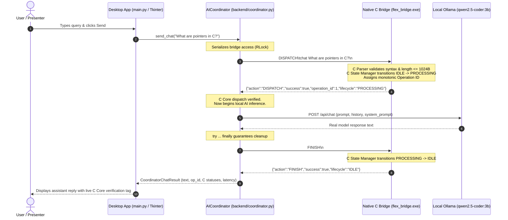

# FLEX 1.0 — College PBL Demonstration Guide

> **Project Based Learning (PBL) Final Submission**  
> **Architecture**: Native C Core (C11) + Python Line Bridge + Local Ollama AI Engine + Polished Desktop UI

---

## 1. Quick Launch (One Command)

To launch the desktop application:

```powershell
python main.py
```

*Note: Ensure the local Ollama daemon is running in a terminal (`ollama serve`) to enable live model responses.*

---

## 2. Executive Summary & Architecture

FLEX 1.0 is a hybrid embedded-and-desktop AI assistant. It couples a strict, deterministic **native C core** with an asynchronous **Python orchestration layer** and **local Ollama inference**.



### Layer Responsibilities

1. **Native C Core (`core-c/`)**:
   - **Command Parser** ([`command_parser.c`](file:///c:/Users/sanid/Documents/GitHub/FLEX-1.0/core-c/src/command_parser.c)): Zero dynamic heap allocation, bounded input scan (`FLEX_MAX_INPUT_LEN = 1024 bytes`), whitespace normalization, argument extraction.
   - **State Manager** ([`state_manager.c`](file:///c:/Users/sanid/Documents/GitHub/FLEX-1.0/core-c/src/state_manager.c)): Lifecycle enforcement (`IDLE`, `PROCESSING`, `STOPPING`), monotonic 64-bit operation IDs, atomic operation tracking (`NONE`, `CHAT`, `VOICE`, `MEMORY`).
   - **Orchestrator** ([`orchestrator.c`](file:///c:/Users/sanid/Documents/GitHub/FLEX-1.0/core-c/src/orchestrator.c)): Atomic command-to-state dispatch; rejects concurrent commands while busy.
   - **Native Bridge Executable** ([`flex_bridge.exe`](file:///c:/Users/sanid/Documents/GitHub/FLEX-1.0/flex_bridge.exe)): Line-based IPC protocol over standard I/O; isolates JSON outputs to `stdout` and debug logs to `stderr`; strips UTF-8 BOMs.

2. **Python Backend & Coordinator (`backend/`)**:
   - **Bridge Client** ([`core_bridge.py`](file:///c:/Users/sanid/Documents/GitHub/FLEX-1.0/backend/core_bridge.py)): Persistent subprocess management, background reader threads, non-blocking I/O queues.
   - **AI Coordinator** ([`coordinator.py`](file:///c:/Users/sanid/Documents/GitHub/FLEX-1.0/backend/coordinator.py)): Guarantees C dispatch succeeds before AI inference begins, guarantees valid C operation cleanup via `finally`, preserves primary errors if cleanup fails, serializes bridge access via `RLock`.
   - **Ollama Provider** ([`ai/ollama_provider.py`](file:///c:/Users/sanid/Documents/GitHub/FLEX-1.0/backend/ai/ollama_provider.py)): Standard-library HTTP client (`urllib.request`) communicating with local daemon; zero hallucinations fabricated.
   - **Conversation History** ([`ai/history.py`](file:///c:/Users/sanid/Documents/GitHub/FLEX-1.0/backend/ai/history.py)): Bounded 50-turn in-memory FIFO conversation history.

3. **Desktop Interface (`backend/app.py` & `main.py`)**:
   - Space-inspired dark visual theme (`#0B0E14` background, electric cyan & pulsar blue accents).
   - Real-time telemetry badges for C Core PID, Lifecycle status, Ollama model availability, and active Operation ID.
   - Non-blocking threaded execution keeping the UI smooth during model inference.
   - Explicit C operation metadata badge attached to every assistant turn.

---

## 3. Feature Status Matrix

| Subsystem / Feature | Status | Notes |
|---|---|---|
| **C11 Command Parser** | **Complete** | 541 unit assertions passing; strict 1024-byte buffer bound. |
| **C11 State Manager** | **Complete** | Monotonic operation IDs, strict state validation. |
| **C11 Orchestrator** | **Complete** | Rejects overlapping concurrent operations. |
| **Native IPC Line Bridge** | **Complete** | 74 automated PowerShell smoke tests passing. |
| **Python Bridge Client** | **Complete** | Zero third-party dependencies, context-manager support. |
| **Python AI Coordinator** | **Complete** | Guaranteed C lifecycle synchronization and cleanup. |
| **Local Ollama Integration** | **Complete** | Connects to `qwen2.5-coder:3b` with zero fabricated text. |
| **Desktop GUI Application** | **Complete** | Tkinter dark space theme with telemetry badges and threaded worker. |
| **In-Memory Multi-Turn History** | **Complete** | Ephemeral bounded 50-turn conversation buffer. |
| *Voice Capture & Synthesis (STT/TTS)* | *Planned (Stage 1G)* | Reserved for future stage. |
| *Persistent Database / Vector Memory* | *Planned (Stage 1G)* | Reserved for future stage (SQLite / vector embeddings). |
| *Firebase Cloud Sync* | *Planned (Stage 2)* | Future remote telemetry integration. |
| *Android Companion App* | *Planned (Stage 2)* | Future mobile frontend. |
| *BLE Hardware Peripherals* | *Planned (Stage 3)* | Future microcontroller connectivity. |

---

## 4. Step-by-Step PBL Demo Sequence

Follow this exact walkthrough during the college PBL evaluation:

### Step 1: Pre-Flight Verification (30 Seconds)
Open PowerShell at the project root and run the aggregate build and test script:
```powershell
.\build_test.ps1
```
**Talking Point**: *"Our automated pipeline compiles the C11 core with GCC `-std=c11 -Wall -Wextra -Werror -pedantic`, executes 541 C unit assertions, validates 74 IPC bridge protocol tests, and runs 104 Python unit and integration tests with zero failures."*

### Step 2: Ensure Local Ollama Service is Active
Check or launch Ollama in a separate terminal:
```powershell
ollama serve
```
Verify model availability:
```powershell
ollama list
```
*(Notice `qwen2.5-coder:3b` is listed locally).*

### Step 3: Launch Desktop Application
```powershell
python main.py
```
**Talking Point**: *"Notice the space-inspired dark interface. In the top-right header, observe the live telemetry: the C Core reports `IDLE` with its native process PID, and Ollama reports `qwen2.5-coder:3b (ONLINE)`."*

### Step 4: Live Interactive Query
Type the following prompt in the input box and press **Enter** or click **SEND**:
```text
Explain what a pointer is in C, and why buffer bounds checking matters.
```
**Talking Point**:
1. *"As soon as Send is clicked, the query is dispatched into `flex_bridge.exe`. The C command parser verifies the syntax, and the C state manager transitions from `IDLE` to `PROCESSING`, assigning a monotonic Operation ID."*
2. *"The Python coordinator then calls the local Ollama instance running `qwen2.5-coder:3b` entirely offline."*
3. *"Notice the metadata tag rendered beneath the response: `[C Core Verified: Op #1 • Parser: FLEX_STATUS_OK • State: FLEX_STATE_OK]`. This proves that the C core was in the loop and that the state manager safely completed cleanup back to `IDLE`."*

### Step 5: Demonstrate State Protection & Bounds
Type an overlong string or test input rejection.
Notice that if C parser limits are exceeded, the C core safely rejects the input without buffer overflow, and the UI reports the exact parser error.

### Step 6: Multi-turn Context & Reset
Send a follow-up query:
```text
Can you show a 3-line example of that?
```
Notice that the assistant remembers the context of pointers.
Click **Clear Conversation** to demonstrate buffer reset, or type `exit` / close the window to verify clean process shutdown.

---

## 5. C-Focused Technical Explanation for Evaluators

### Why use C11 for the foundational core?
1. **Deterministic Execution**: The C core has zero dynamic memory allocations (`malloc`/`free`) on the request path. All parsing and state tracking use bounded static buffers (`FLEX_MAX_INPUT_LEN = 1024`).
2. **Buffer Overflow Immunity**: By enforcing strict input boundary checks at the C level, malformed or malicious inputs are rejected before they reach backend business logic.
3. **State Machine Integrity**: Modern AI assistants often suffer from race conditions when users send overlapping requests. The C State Manager strictly enforces that only one operation can be in `PROCESSING` at a time, preventing state corruption.
4. **Separation of Concerns**: Safety-critical command parsing and lifecycle tracking belong in a low-level native language, while AI inference and presentation belong in higher-level languages.

---

## 6. Automated Test Commands

- **Run Everything (C tests + Bridge smoke tests + Python tests)**:
  ```powershell
  .\build_test.ps1
  ```
- **Run Only Python Unit & Integration Tests**:
  ```powershell
  python -m unittest discover -s backend/tests -v
  ```
- **Run Live Ollama Pipeline Integration Tests**:
  ```powershell
  $env:FLEX_RUN_OLLAMA_TESTS="1"; python -m unittest backend.tests.test_coordinator.TestAICoordinatorLiveIntegration -v
  ```
