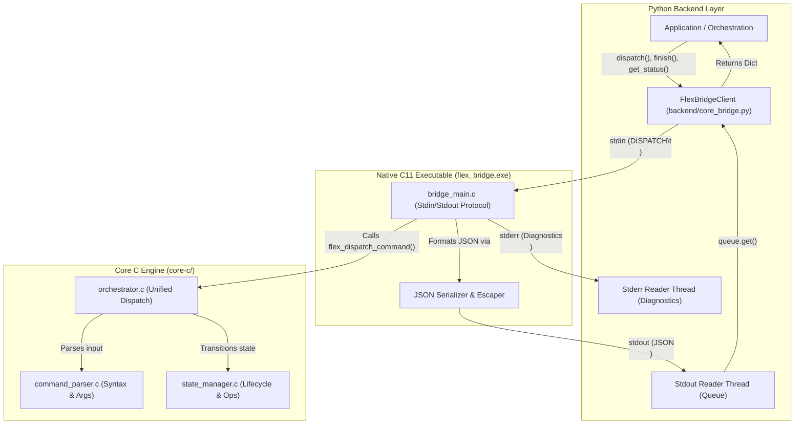
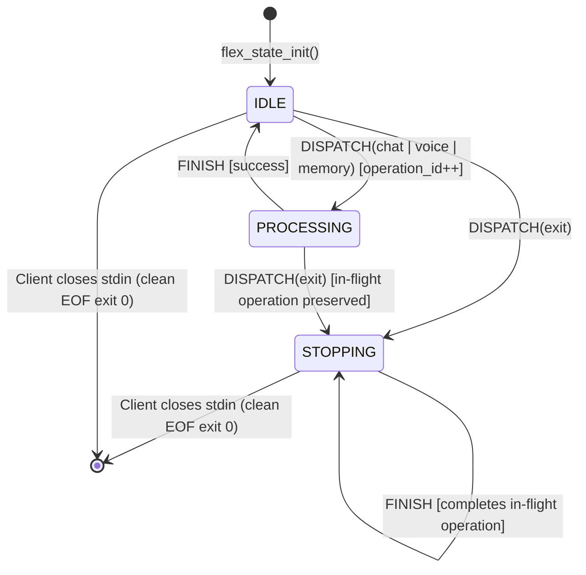

# FLEX 1.0 — Architecture and System Design

## 1. Executive Summary

FLEX 1.0 is designed as a hybrid native-core assistant system. The foundational core is implemented in portable, strict C11 (`core-c/`) for deterministic state tracking, command syntax normalization, and memory safety without dynamic heap allocations. Communicating over a line-based standard input/output (IPC) bridge, the Python client (`backend/core_bridge.py`) manages the native process lifecycle and provides a robust, Pythonic interface for higher-level application components.

> [!NOTE]
> **Stage 1E.4 Scope Notice**:
> Command dispatch currently confirms syntactic parsing and orchestrator state transitions in the C core. Command execution does **not** currently perform AI inference, local model generation, voice synthesis/capture, or database storage. Those components belong to subsequent development stages.

---

## 2. Component Architecture



### Module Responsibilities

| Component | Language / Location | Primary Responsibility |
|---|---|---|
| **Command Parser** | C11 ([`core-c/src/command_parser.c`](file:///c:/Users/sanid/Documents/GitHub/FLEX-1.0/core-c/src/command_parser.c)) | Validates command verbs, trims whitespace, extracts arguments, normalizes command names, and enforces bounds (`FLEX_MAX_INPUT_LEN = 1024`). Zero dynamic heap allocations. |
| **State Manager** | C11 ([`core-c/src/state_manager.c`](file:///c:/Users/sanid/Documents/GitHub/FLEX-1.0/core-c/src/state_manager.c)) | Enforces the application lifecycle (`IDLE`, `PROCESSING`, `STOPPING`), tracks the active operation (`NONE`, `CHAT`, `VOICE`, `MEMORY`), assigns monotonic 64-bit operation IDs, and protects against invalid transitions. |
| **Orchestrator** | C11 ([`core-c/src/orchestrator.c`](file:///c:/Users/sanid/Documents/GitHub/FLEX-1.0/core-c/src/orchestrator.c)) | Combines parser and state manager into an atomic dispatch routine. Evaluates syntax first; transitions state only if syntax is valid and state permits. Rejects concurrent operations while busy. |
| **Bridge Executable** | C11 ([`core-c/src/bridge_main.c`](file:///c:/Users/sanid/Documents/GitHub/FLEX-1.0/core-c/src/bridge_main.c)) | Standalone executable (`flex_bridge.exe`). Reads line-based requests from `stdin`, runs orchestrator actions, drains oversized lines, serializes responses to JSON on `stdout`, and isolates diagnostics to `stderr`. |
| **Bridge Client** | Python ([`backend/core_bridge.py`](file:///c:/Users/sanid/Documents/GitHub/FLEX-1.0/backend/core_bridge.py)) | Manages the persistent subprocess (`subprocess.Popen`), runs background reader threads, enforces bounded timeouts, decodes JSON responses, and exposes clean Python APIs and context managers. |

---

## 3. Communication Protocol Specification

Communication between Python and the native bridge occurs over standard pipes using a line-based request protocol and single-line JSON responses.

### 3.1 Request Framing (stdin)
Requests must be terminated by a newline (`\n` or `\r\n`).

| Request Command | Delimiter | Arguments / Remainder | Description |
|---|---|---|---|
| `DISPATCH` | `\t` (Literal Tab) | `<command>` | Dispatches a command string to the core orchestrator. |
| `FINISH` | None | None | Explicitly completes the active operation and returns lifecycle to `IDLE` (or keeps `STOPPING`). |
| `STATUS` | None | None | Queries the current lifecycle state, active operation, operation ID, and last error. |
| `RESET_ERROR` | None | None | Resets recoverable state manager error status to `FLEX_STATE_OK`. |

> [!WARNING]
> Requests must **not** contain embedded newlines. In Python, `FlexBridgeClient.dispatch()` verifies this and raises `ValueError` before transmission to avoid framing corruption.

### 3.2 Response Framing (stdout)
Every accepted or rejected request produces **exactly one JSON object** on `stdout` followed by a single newline (`\n`), flushed immediately with `fflush(stdout)`.

#### Response Schemas

##### 1. `DISPATCH` Response
```json
{
  "action": "DISPATCH",
  "success": true,
  "parser_status": "FLEX_STATUS_OK",
  "state_status": "FLEX_STATE_OK",
  "command_type": "FLEX_COMMAND_CHAT",
  "operation": "FLEX_OPERATION_CHAT",
  "operation_id": 1,
  "operation_started": true,
  "shutdown_requested": false,
  "command_name": "chat",
  "args": "Explain pointers in C",
  "lifecycle": "FLEX_LIFECYCLE_PROCESSING",
  "active_operation": "FLEX_OPERATION_CHAT"
}
```

##### 2. `FINISH` Response
```json
{
  "action": "FINISH",
  "success": true,
  "state_status": "FLEX_STATE_OK",
  "lifecycle": "FLEX_LIFECYCLE_IDLE",
  "active_operation": "FLEX_OPERATION_NONE",
  "operation_id": 1
}
```

##### 3. `STATUS` Response
```json
{
  "action": "STATUS",
  "success": true,
  "lifecycle": "FLEX_LIFECYCLE_IDLE",
  "active_operation": "FLEX_OPERATION_NONE",
  "operation_id": 1,
  "last_error": "FLEX_STATE_OK"
}
```

##### 4. `RESET_ERROR` Response
```json
{
  "action": "RESET_ERROR",
  "success": true,
  "state_status": "FLEX_STATE_OK",
  "last_error": "FLEX_STATE_OK"
}
```

##### 5. `ERROR` Response (Protocol & Framing Errors)
```json
{
  "action": "ERROR",
  "success": false,
  "error": "MALFORMED_REQUEST",
  "message": "DISPATCH requires <TAB> separator before command"
}
```

Common error codes returned in `ERROR` response:
- `EMPTY_REQUEST`: An empty line or carriage return was sent.
- `MALFORMED_REQUEST`: Missing `<TAB>` separator after `DISPATCH`.
- `UNKNOWN_ACTION`: Action verb is not one of `DISPATCH`, `FINISH`, `STATUS`, `RESET_ERROR`.
- `REQUEST_TOO_LONG`: The request line exceeded the bridge line buffer (`BRIDGE_BUFFER_SIZE = 2048`). Excess characters are consumed until newline.

---

## 4. State Model and Operation Lifecycle

### 4.1 Lifecycle States
- **`FLEX_LIFECYCLE_IDLE` (0)**: Initial ready state. No operations running. New operations accepted.
- **`FLEX_LIFECYCLE_PROCESSING` (1)**: An operation is actively running (`CHAT`, `VOICE`, or `MEMORY`). Concurrent operations are rejected with `FLEX_STATE_ERROR_ALREADY_PROCESSING`.
- **`FLEX_LIFECYCLE_STOPPING` (2)**: Shutdown has been requested (e.g. via `exit`). No new operations can start (`FLEX_STATE_ERROR_STOPPING`). An in-flight operation is permitted to complete.

### 4.2 State Transition Diagram



### 4.3 Monotonic Operation Identifiers
- Each successful transition from `IDLE` to `PROCESSING` increments `current_operation_id` by 1.
- Operation IDs are 64-bit unsigned integers (`uint64_t`).
- Failed or rejected dispatches do **not** increment the operation ID.
- The operation ID persists across `FINISH` and is reported in subsequent `STATUS` queries, enabling callers to track operation sequencing.
- Overflow protection guards at `UINT64_MAX` with `FLEX_STATE_ERROR_ID_OVERFLOW`.

---

## 5. Buffer Limits, UTF-8, and Memory Boundaries

| Boundary | Value | Definition Location | Description |
|---|---|---|---|
| Command Limit | 1024 bytes | [`core-c/include/command_parser.h`](file:///c:/Users/sanid/Documents/GitHub/FLEX-1.0/core-c/include/command_parser.h) (`FLEX_MAX_INPUT_LEN`) | Maximum command length accepted by parser. Longer commands return `FLEX_STATUS_INPUT_TOO_LONG`. |
| Verb Limit | 64 bytes | [`core-c/include/command_parser.h`](file:///c:/Users/sanid/Documents/GitHub/FLEX-1.0/core-c/include/command_parser.h) (`FLEX_MAX_COMMAND_LEN`) | Maximum length of normalized command verb. |
| Args Limit | 1024 bytes | [`core-c/include/command_parser.h`](file:///c:/Users/sanid/Documents/GitHub/FLEX-1.0/core-c/include/command_parser.h) (`FLEX_MAX_ARGS_LEN`) | Maximum length of parsed argument buffer. |
| Bridge Line Buffer | 2048 bytes | [`core-c/src/bridge_main.c`](file:///c:/Users/sanid/Documents/GitHub/FLEX-1.0/core-c/src/bridge_main.c) (`BRIDGE_BUFFER_SIZE`) | Line buffer capacity for reading `stdin`. Overlong lines trigger `REQUEST_TOO_LONG` and line drainage. |

### Unicode Byte Count vs. Character Count
- Python measures string length (`len(s)`) in Unicode characters (code points).
- The C core measures string length in UTF-8 bytes using bounded linear scans (`while (input[len] != '\0')`).
- Multi-byte characters consume 2 to 4 UTF-8 bytes per character:
  - English ASCII (`A`): 1 char = 1 byte
  - Accented Latin (`é`): 1 char = 2 bytes
  - Devanagari (`ह`): 1 char = 3 bytes
  - Emoji (`🚀`): 1 char = 4 bytes
- A 400-character string of emojis requires 1600 UTF-8 bytes and will be rejected by the C parser with `FLEX_STATUS_INPUT_TOO_LONG` despite being only 400 characters in Python.

---

## 6. Process Lifecycle, Concurrency, and Restarts

### 6.1 Subprocess Management
- The native bridge executable is launched as a persistent subprocess via Python's standard `subprocess.Popen`.
- Two background daemon threads read pipes asynchronously:
  - **Stdout Reader Thread**: Reads lines into a thread-safe `queue.Queue`.
  - **Stderr Reader Thread**: Collects diagnostic lines into a thread-safe list.
- Standard output is never mixed with diagnostic messages or compiler output.

### 6.2 Strict No-Silent-Restart Rule
- The C state manager maintains state entirely in process memory.
- If the native bridge process terminates or crashes, all state (lifecycle, in-flight operations, operation IDs) is permanently lost.
- **Therefore, `FlexBridgeClient` never automatically restarts a failed process.**
- A broken pipe or dead process raises `FlexBridgeProcessError` with the process exit code and captured stderr diagnostics.
- Callers must explicitly decide to reinitialize by calling `client.restart(force=True)`. Calling `restart(force=False)` will fail if an operation is known to be in flight.

### 6.3 Concurrency and Thread Safety
- The C bridge executable is single-threaded and expects sequential request-response turns.
- A single `FlexBridgeClient` instance is designed for single-thread operation or serialized calls. Concurrent calls on the same client instance without external synchronization will interleave request lines and corrupt response order.
- Multiple independent client instances running separate subprocesses are fully isolated.

---

## 7. Feature Implementation Status

| Feature / Capability | Status | Implementation Details |
|---|---|---|
| C Command Parser | **Implemented & Tested** | Full regression and structured parser tests (Stage 1A & 1B). |
| C State Manager | **Implemented & Tested** | In-memory lifecycle and operation tracking (Stage 1C). |
| C Orchestrator | **Implemented & Tested** | Atomic dispatch connecting parser and state manager (Stage 1D). |
| Native Bridge Executable | **Implemented & Tested** | Stdin/stdout line IPC, RFC 8259 escaping, drainage (Stage 1E.1). |
| Python Client (`FlexBridgeClient`) | **Implemented & Tested** | Subprocess management, timeouts, custom exceptions (Stage 1E.2). |
| End-to-End Integration Suite | **Implemented & Tested** | Full Python-to-C pipeline test suite with 20 tests (Stage 1E.3). |
| Local AI / Ollama Inference | **Planned (Not Implemented)** | Dispatching `chat` currently only moves state to `PROCESSING`. |
| Voice Capture / STT / TTS | **Planned (Not Implemented)** | Dispatching `voice` only moves state to `PROCESSING`. |
| Persistent Memory / Database | **Planned (Not Implemented)** | Dispatching `memory` only moves state to `PROCESSING`. |
| Firebase Cloud Integration | **Planned (Not Implemented)** | No cloud networking exists in the codebase. |
| UI / Android Application | **Planned (Not Implemented)** | No graphical interface or mobile bindings exist yet. |
