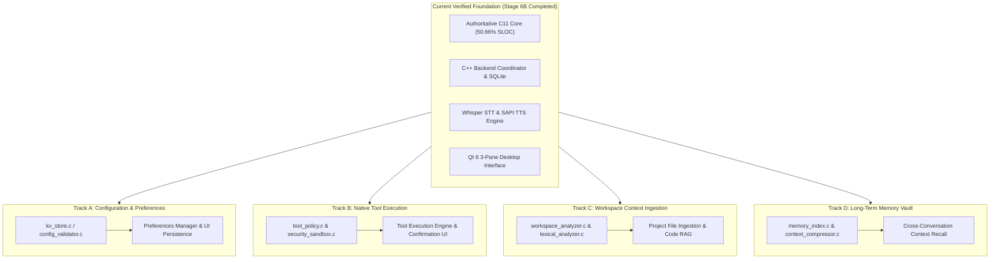

# FLEX 1.0 — Next Development Roadmap & Feature Implementation Specification

**Project**: FLEX 1.0 (College PBL Capstone Project)  
**Location**: `C:\Users\sanid\Documents\GitHub\FLEX-1.0`  
**Date**: October 29, 2026  
**Status**: Architecture Hardened & Verified — Ready for Feature Expansion  

---

## 1. Executive Overview & Development Philosophy

With the completion of the native architecture consolidation, dead-code stripping, algorithmic optimization, and the establishment of the canonical C string utility engine, **FLEX 1.0 has proven production stability**:
- **Authoritative C Core**: 7,412 C production SLOC (50.66%), surpassing the 50.0% college PBL threshold.
- **Native Test Coverage**: 987 / 987 C assertions passing (0 failures), and 7 / 7 native CTest suites passing.
- **Hardware Integrations Active**: Local Ollama client, SQLite database persistence, WASAPI microphone capture, whisper.cpp speech recognition, and Windows SAPI text-to-speech.

The purpose of this roadmap is to guide the implementation of the remaining incomplete application features with **explicit boundary separation**:
- **C11 Core Responsibilities**: Pure systems logic, deterministic state machines, memory indexing, string parsing, tokenization, policy enforcement, rate limiting, and DSP.
- **C++17 / Qt 6 Responsibilities**: Asynchronous event dispatching, desktop UI layout, OS audio streams, HTTP network communication, and SQLite schema binding.

---

## 2. Capability Audit & Implementation Tracks

---

### Track A: Settings Persistence & Hardware Preferences

#### Current Implementation Status
`SettingsView` exists and enables live testing of Ollama endpoints and model parameters in memory, but configuration changes revert to defaults on application restart. Audio device selection is currently automatic via Qt Multimedia default device.

#### Missing Functionality
1. Persistent serialization of user settings to disk (`%LOCALAPPDATA%\FLEX\config.ini`).
2. Audio input device drop-down selector (enumerating microphones via `QMediaDevices::audioInputs()`).
3. Audio output / TTS voice drop-down selector (enumerating installed SAPI voices).
4. Automatic model enumeration from local Ollama daemon (`/api/tags`) to populate the model picker.

#### Relevant Existing Modules
- [`core-c/include/kv_store.h`](file:///c:/Users/sanid/Documents/GitHub/FLEX-1.0/core-c/include/kv_store.h) & [`core-c/src/kv_store.c`](file:///c:/Users/sanid/Documents/GitHub/FLEX-1.0/core-c/src/kv_store.c)
- [`core-c/include/config_validator.h`](file:///c:/Users/sanid/Documents/GitHub/FLEX-1.0/core-c/include/config_validator.h) & [`core-c/src/config_validator.c`](file:///c:/Users/sanid/Documents/GitHub/FLEX-1.0/core-c/src/config_validator.c)
- [`src-cpp/include/flex/ui/settings_view.hpp`](file:///c:/Users/sanid/Documents/GitHub/FLEX-1.0/src-cpp/include/flex/ui/settings_view.hpp) & [`src-cpp/src/ui/settings_view.cpp`](file:///c:/Users/sanid/Documents/GitHub/FLEX-1.0/src-cpp/src/ui/settings_view.cpp)

#### Architectural Responsibility Split
- **C Core**: `kv_store.c` parses and serializes INI key-value records. `config_validator.c` enforces valid ranges (endpoint URLs, temperature $0.0 \le T \le 2.0$, context limits $\le 32768$).
- **C++/Qt**: Reads/writes configuration file from user profile, populates combo boxes from OS multimedia devices and Ollama API, and signals components on configuration change.

#### Security & Privacy Considerations
- Prevent path traversal when saving configuration.
- Validate that the endpoint URL is restricted to valid HTTP/HTTPS schemes without embedded credentials.

#### Required Tests
- Unit test in `test_c_core_modules.c` for `config_validator` and `kv_store` round-trip serialization.
- UI test in `test_ui.cpp` verifying settings change emission and UI state restoration.

#### Acceptance Criteria
- User can select an alternate Ollama model and change temperature; settings persist across application restarts.
- Available audio capture devices appear in a combo box and switching devices updates the audio service.

---

### Track B: Native Tool Execution Engine & Safe System Policies

#### Current Implementation Status
`core-c/src/tool_policy.c` and `core-c/src/security_sandbox.c` are fully implemented and verified with unit tests, defining permissions (`READ_ONLY`, `WORKSPACE_WRITE`, `SYSTEM_EXEC`), invocation counters, path sandboxing, and token buckets. However, Ollama model tool calls are not yet dispatched to native execution handlers.

#### Missing Functionality
1. Extraction of tool call requests from Ollama model responses (JSON payload parser).
2. Native tool dispatcher executing approved tools:
   - `calc(expression)`: Safe math evaluator via `core-c/src/math_evaluator.c`.
   - `read_file(path)`: Bounded workspace file reader constrained by `security_sandbox.c`.
   - `list_dir(path)`: Directory inventory bounded to workspace root.
   - `sys_info()`: System metrics via `core-c/src/sysinfo_collector.c`.
3. Modal or inline UI confirmation banner when a tool requires explicit user authorization (`FLEX_TOOL_REJECT_NEEDS_USER_CONFIRM`).
4. Re-injection of tool output back into the chat conversation turn as role `tool`.

#### Relevant Existing Modules
- [`core-c/include/tool_policy.h`](file:///c:/Users/sanid/Documents/GitHub/FLEX-1.0/core-c/include/tool_policy.h) & [`core-c/src/tool_policy.c`](file:///c:/Users/sanid/Documents/GitHub/FLEX-1.0/core-c/src/tool_policy.c)
- [`core-c/include/security_sandbox.h`](file:///c:/Users/sanid/Documents/GitHub/FLEX-1.0/core-c/include/security_sandbox.h) & [`core-c/src/security_sandbox.c`](file:///c:/Users/sanid/Documents/GitHub/FLEX-1.0/core-c/src/security_sandbox.c)
- [`core-c/include/math_evaluator.h`](file:///c:/Users/sanid/Documents/GitHub/FLEX-1.0/core-c/include/math_evaluator.h) & [`core-c/src/math_evaluator.c`](file:///c:/Users/sanid/Documents/GitHub/FLEX-1.0/core-c/src/math_evaluator.c)
- [`src-cpp/src/backend.cpp`](file:///c:/Users/sanid/Documents/GitHub/FLEX-1.0/src-cpp/src/backend.cpp)

#### Architectural Responsibility Split
- **C Core**: Policy authorization (`flex_tool_authorize_call`), rate limiting, sandbox path containment check (`flex_sandbox_is_path_allowed`), and mathematical expression evaluation.
- **C++/Qt**: JSON tool invocation extraction, file I/O within sandbox constraints, UI confirmation prompt display, and conversation loopback.

#### Security & Privacy Considerations
- **Strict Sandboxing**: No read or write access outside the active workspace directory.
- **No Direct Shell Execution**: Shell commands (`cmd.exe`, `powershell.exe`) must be blocked by `security_sandbox.c`.
- **Bounded Tool Output**: Cap tool response payloads at 4,096 bytes to avoid blowing out model context limits.

#### Required Tests
- Mock tool invocation tests verifying permission rejection for unauthorized paths.
- UI confirmation rejection test verifying that declining tool authorization aborts execution cleanly.

#### Acceptance Criteria
- Asking the assistant "What is 45 * 12 + sqrt(144)?" invokes the native `calc` tool through `math_evaluator.c` and presents the verified result.
- Attempting to access `C:\Windows` via a tool call is rejected by `security_sandbox.c` with an explicit security alert.

---

### Track C: Workspace Context Ingestion (Project Files & Code RAG)

#### Current Implementation Status
`ProjectsView` provides a filesystem tree browser and text previewer with dynamic workspace root detection. C core modules `workspace_analyzer.c`, `lexical_analyzer.c`, and `text_tokenizer.c` are fully built and tested. However, clicking a file does not currently attach it to the prompt context.

#### Missing Functionality
1. "Add to Chat Context" action in `ProjectsView` context menu and toolbar.
2. Context attachment chip container above chat input in `ChatView`.
3. Bounded file context formatter formatting code blocks with syntax tags determined by `lexical_analyzer.c`.
4. Token budget guard ensuring attached files do not exceed the configured context window limit (e.g. 2,048 tokens).

#### Relevant Existing Modules
- [`core-c/include/workspace_analyzer.h`](file:///c:/Users/sanid/Documents/GitHub/FLEX-1.0/core-c/include/workspace_analyzer.h) & [`core-c/src/workspace_analyzer.c`](file:///c:/Users/sanid/Documents/GitHub/FLEX-1.0/core-c/src/workspace_analyzer.c)
- [`core-c/include/lexical_analyzer.h`](file:///c:/Users/sanid/Documents/GitHub/FLEX-1.0/core-c/include/lexical_analyzer.h) & [`core-c/src/lexical_analyzer.c`](file:///c:/Users/sanid/Documents/GitHub/FLEX-1.0/core-c/src/lexical_analyzer.c)
- [`core-c/include/text_tokenizer.h`](file:///c:/Users/sanid/Documents/GitHub/FLEX-1.0/core-c/include/text_tokenizer.h) & [`core-c/src/text_tokenizer.c`](file:///c:/Users/sanid/Documents/GitHub/FLEX-1.0/core-c/src/text_tokenizer.c)
- [`src-cpp/src/ui/projects_view.cpp`](file:///c:/Users/sanid/Documents/GitHub/FLEX-1.0/src-cpp/src/ui/projects_view.cpp)
- [`src-cpp/src/ui/chat_view.cpp`](file:///c:/Users/sanid/Documents/GitHub/FLEX-1.0/src-cpp/src/ui/chat_view.cpp)

#### Architectural Responsibility Split
- **C Core**: File classification by extension (`flex_classify_file_extension`), markdown fence language detection (`flex_lex_detect_language`), token count estimation (`flex_estimate_token_count`).
- **C++/Qt**: File tree selection, reading local file content, displaying attachment chips with remove buttons in `ChatView`, assembling multi-file prompt context.

#### Security & Privacy Considerations
- Restrict file reading to binary-safe text files under 256 KB.
- Exclude `.git`, `build`, `node_modules`, and binary model files from automatic context injection.

#### Required Tests
- Attachment of single and multiple files into `ChatView`.
- Token budget overflow test verifying that oversized files trigger a warning before submission.

#### Acceptance Criteria
- User can right-click a source file in `ProjectsView`, select "Add to Chat", see an attachment pill in `ChatView`, and ask questions about the file's contents with accurate AI answers.

---

### Track D: Long-Term Memory & Context Retrieval

#### Current Implementation Status
`MemoryView` provides conversation search and inspection of SQLite history. `core-c/src/memory_index.c` implements an in-memory keyword and stem search index, and `core-c/src/context_compressor.c` extracts key terms and filters stopwords.

#### Missing Functionality
1. Automatic indexing of assistant and user messages into `flex_memory_index_t`.
2. Cross-conversation semantic search enabling the assistant to recall facts stated in earlier chats (e.g. "What was the project name I mentioned last week?").
3. Context compression: extracting salient terms from older turns to prevent context truncation during long sessions.
4. Export conversation to Markdown / Plain Text file.

#### Relevant Existing Modules
- [`core-c/include/memory_index.h`](file:///c:/Users/sanid/Documents/GitHub/FLEX-1.0/core-c/include/memory_index.h) & [`core-c/src/memory_index.c`](file:///c:/Users/sanid/Documents/GitHub/FLEX-1.0/core-c/src/memory_index.c)
- [`core-c/include/context_compressor.h`](file:///c:/Users/sanid/Documents/GitHub/FLEX-1.0/core-c/include/context_compressor.h) & [`core-c/src/context_compressor.c`](file:///c:/Users/sanid/Documents/GitHub/FLEX-1.0/core-c/src/context_compressor.c)
- [`src-cpp/src/ui/memory_view.cpp`](file:///c:/Users/sanid/Documents/GitHub/FLEX-1.0/src-cpp/src/ui/memory_view.cpp)
- [`src-cpp/src/storage.cpp`](file:///c:/Users/sanid/Documents/GitHub/FLEX-1.0/src-cpp/src/storage.cpp)

#### Architectural Responsibility Split
- **C Core**: In-memory ring buffer of indexed records (`flex_memory_index_t`), case-insensitive fast substring and stemmed query scoring, key-term extraction and stopword elimination.
- **C++/Qt**: SQLite persistence, background index population on startup, memory search UI, conversation export dialog.

#### Security & Privacy Considerations
- Complete user control over memory: "Purge All Memory" button must securely delete records from SQLite and clear in-memory indices immediately.
- Never export memory or telemetry to external network endpoints.

#### Required Tests
- Search ranking tests verifying relevance ordering of multi-term queries.
- Memory purge verification confirming zero residual records in database and memory.

#### Acceptance Criteria
- User can search across all past conversations in `MemoryView` and jump directly to the turn containing the matched text.
- Export conversation produces a clean, human-readable Markdown transcript with timestamps.

---

### Track E: Production Packaging & Standalone Installer

#### Current Implementation Status
The project builds natively via `CMakeLists.txt` and Ninja using MinGW-w64 GCC 13.1.0 and Qt 6. Automated PowerShell build and test scripts are in place.

#### Missing Functionality
1. CPack configuration in `CMakeLists.txt` for generating a self-contained Windows NSIS installer or ZIP archive.
2. Automated deployment script running Qt `windeployqt.exe` to collect required Qt runtime libraries.
3. Bundled Whisper model downloader or verification step during installation.
4. Application desktop icon and file association registration.

---

## 3. Recommended Implementation Order

To maintain strict stability and ensure tests pass at every step, the following sequential execution order is recommended:

| Step | Track | Objective | Primary Deliverables | Target Gate |
| :---: | :---: | :--- | :--- | :--- |
| **1** | **Track A** | Settings Persistence & Hardware Preferences | `config.ini` serialization via `kv_store.c`, audio input device selection | Settings survive reboot |
| **2** | **Track C** | Project Context Ingestion | "Add to Chat" file pills in `ChatView`, token count checks | Inspect code files in chat |
| **3** | **Track B** | Native Tool Execution | `calc` and `read_file` tool dispatcher, confirmation UI | Safe math/file tool execution |
| **4** | **Track D** | Long-Term Memory Retrieval | Cross-chat memory search, Markdown transcript export | Search all past chats |
| **5** | **Track E** | Packaging & Installer | CPack configuration, `windeployqt` automated packaging | Standalone Windows installer |

---

## 4. Quality & Architectural Gates for Remaining Phases

Every subsequent implementation step must adhere to these non-negotiable standards:
1. **Authoritative C Core**: First-party production C code must remain $\ge 50.0\%$ measured by `scripts/measure_loc.ps1`.
2. **Zero Python Runtime**: No Python runtime dependencies or wrappers may be reintroduced.
3. **Deterministic Safety**: All C functions must respect `FLEX_MAX_INPUT_LEN = 1024` or explicit buffer capacities, with zero dynamic heap allocations in inner loops.
4. **100% Passing Tests**: All 7 native test suites and 41 C core test suites must pass on every change before completion.

