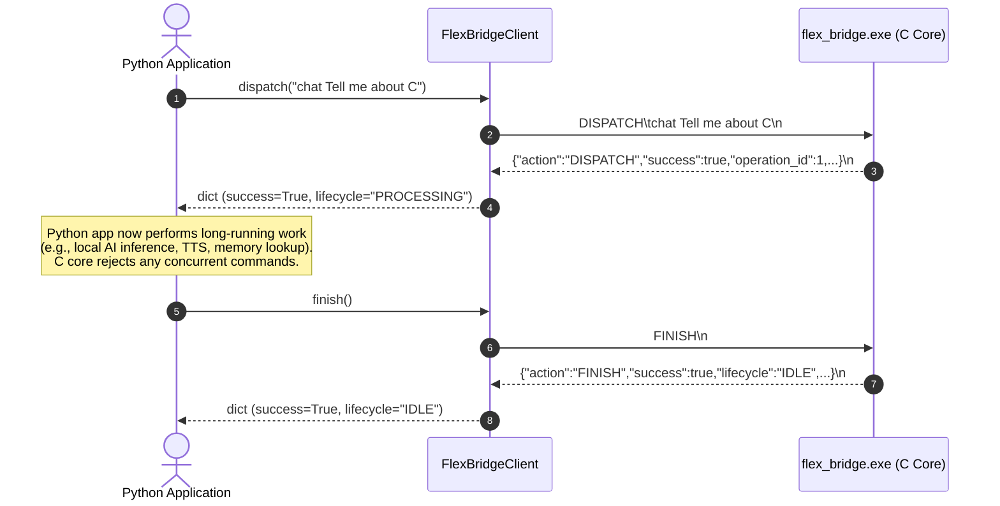

# FLEX 1.0 — Python Integration Guide & Contract

## 1. Overview and Core Contract Boundary

This document describes how Python backend services, API adapters, or test harnesses should integrate with the native C core using [`backend/core_bridge.py`](file:///c:/Users/sanid/Documents/GitHub/FLEX-1.0/backend/core_bridge.py).

> [!IMPORTANT]
> **Critical Architectural Boundary**:
> When `client.dispatch("chat Hello")` returns `{"success": true}`, it means that:
> 1. The C parser recognized `chat` as a valid verb.
> 2. The arguments were extracted and validated within buffer bounds.
> 3. The C state manager transitioned from `FLEX_LIFECYCLE_IDLE` to `FLEX_LIFECYCLE_PROCESSING`.
> 4. An active operation `FLEX_OPERATION_CHAT` was registered with a monotonic operation ID.
> 
> **It does NOT mean that an AI model has generated a reply.**
> The Python application is responsible for executing external AI work (e.g. calling Ollama or a local LLM) while the C state manager remains in `PROCESSING`. Once the AI response is complete, the Python caller must invoke `client.finish()` to return the C core to `IDLE`.

---

## 2. Installation and Executable Resolution

`FlexBridgeClient` requires no third-party Python packages—it is built entirely using Python's standard library (`subprocess`, `threading`, `queue`, `json`, `pathlib`).

### 2.1 Default Resolution Order
When instantiating `FlexBridgeClient()` without an explicit path:
1. `FLEX_BRIDGE_EXE` environment variable (if set).
2. `<repo_root>/flex_bridge.exe`
3. `<repo_root>/core-c/flex_bridge.exe`
4. Executable lookup on system `PATH` (`flex_bridge.exe` or `flex_bridge`).

If the binary cannot be found, `FlexBridgeNotFoundError` is raised immediately.

### 2.2 Configuration Examples
```python
from backend.core_bridge import FlexBridgeClient

# 1. Automatic resolution (standard usage in repository):
client = FlexBridgeClient()

# 2. Explicit path configuration:
client = FlexBridgeClient(executable_path="C:/custom/path/flex_bridge.exe")

# 3. Custom request timeout (seconds):
client = FlexBridgeClient(timeout=10.0)
```

---

## 3. Client Lifecycle and Context Manager

### 3.1 Recommended Pattern: Context Manager (`with`)
The context manager guarantees that the subprocess is started on entry and cleanly closed on exit, even if an unhandled exception occurs in Python.

```python
from backend.core_bridge import FlexBridgeClient

with FlexBridgeClient() as client:
    # Subprocess is started and verified alive
    status = client.get_status()
    print("Initial lifecycle:", status["lifecycle"])

# Subprocess is guaranteed to be closed upon exit
```

### 3.2 Manual Lifecycle Control
For long-lived server processes (e.g. FastAPI / Flask / background daemon):

```python
from backend.core_bridge import FlexBridgeClient

client = FlexBridgeClient()
client.start()

try:
    # Use client across application lifecycle
    res = client.dispatch("chat Explain pointers")
    # ... perform processing ...
    client.finish()
finally:
    client.close(timeout=2.0)
```

---

## 4. Operation Workflow: Dispatch, Processing, and Explicit Finish



### Python Code Example
```python
from backend.core_bridge import FlexBridgeClient

with FlexBridgeClient() as client:
    # Step 1: Dispatch command to start operation
    dispatch_res = client.dispatch("chat Tell me about pointers in C")
    if not dispatch_res["success"]:
        print("Command rejected:", dispatch_res["parser_status"])
        return

    op_id = dispatch_res["operation_id"]
    print(f"Operation #{op_id} started. Lifecycle: {dispatch_res['lifecycle']}")

    # Step 2: (Future Stage) Execute external AI / Ollama inference here
    # While this executes, client.get_status() returns 'FLEX_LIFECYCLE_PROCESSING'
    # Any other dispatch will be safely rejected with 'FLEX_STATE_ERROR_ALREADY_PROCESSING'

    # Step 3: Explicitly finish the operation
    finish_res = client.finish()
    print(f"Operation #{op_id} finished. Lifecycle returned to: {finish_res['lifecycle']}")
```

---

## 5. Error Differentiation and Exception Handling

The bridge interface cleanly separates three distinct classes of errors:

1. **Transport / Process Exceptions**: Subprocess crashed, binary missing, broken pipe, or timeout.
2. **Parser Syntax Errors**: Malformed command, unknown verb, or oversized input (reported in response dictionary).
3. **State Manager Errors**: State violation such as concurrent operation attempts or invalid finishes (reported in response dictionary).

### 5.1 Handling Python Exceptions
```python
from backend.core_bridge import (
    FlexBridgeClient,
    FlexBridgeNotFoundError,
    FlexBridgeProcessError,
    FlexBridgeTimeoutError,
    FlexBridgeProtocolError,
)

try:
    with FlexBridgeClient(timeout=3.0) as client:
        res = client.dispatch("chat Hello")
except FlexBridgeNotFoundError as e:
    print(f"Executable missing: {e}")
except FlexBridgeTimeoutError as e:
    print(f"Bridge read timed out: {e}")
except FlexBridgeProcessError as e:
    # Raised if bridge process crashed or broken pipe occurred
    print(f"Process failure: {e}")
except FlexBridgeProtocolError as e:
    # Raised if bridge returned malformed JSON or unexpected EOF
    print(f"Protocol violation: {e}")
```

### 5.2 Distinguishing Parser vs. State Errors in Response Dict
```python
res = client.dispatch("unknown_verb with arguments")

if not res["success"]:
    # 1. Parser Syntax Error (state was NOT modified):
    if res["parser_status"] != "FLEX_STATUS_OK":
        print(f"Syntax/Parser Error: {res['parser_status']}")
        # e.g. FLEX_STATUS_UNKNOWN_COMMAND, FLEX_STATUS_EMPTY_INPUT, FLEX_STATUS_INPUT_TOO_LONG

    # 2. State Transition Error (command was valid, but state rejected it):
    elif res["state_status"] != "FLEX_STATE_OK":
        print(f"State Error: {res['state_status']}")
        # e.g. FLEX_STATE_ERROR_ALREADY_PROCESSING, FLEX_STATE_ERROR_STOPPING
```

---

## 6. Input Limits, Encoding, and Framing Rules

| Limit | Maximum Allowed | Failure Behavior |
|---|---|---|
| **Command Length** | 1024 UTF-8 bytes | `dispatch_res["parser_status"] == "FLEX_STATUS_INPUT_TOO_LONG"` |
| **Bridge Line Buffer** | 2048 UTF-8 bytes | `dispatch_res["error"] == "REQUEST_TOO_LONG"` |
| **Newlines in Command** | 0 newlines (`\n` or `\r`) | Raises `ValueError` before transmission |

### UTF-8 Byte Length vs. Python Characters
Always be mindful of multi-byte characters:
```python
from backend.core_bridge import utf8_byte_length

text = "Hello 🚀 " + ("नमस्ते " * 50)
print("Character count:", len(text))             # e.g. 358 characters
print("UTF-8 byte count:", utf8_byte_length(text)) # e.g. 708 bytes
```

---

## 7. Shutdown, Restarts, and State Loss

### 7.1 Graceful Shutdown (`exit`)
Dispatching `exit` requests a graceful shutdown:
```python
res = client.dispatch("exit")
print("Shutdown requested:", res["shutdown_requested"]) # True
print("Lifecycle:", res["lifecycle"])                   # FLEX_LIFECYCLE_STOPPING
```
- If an operation was active, it is **not** aborted silently. The caller can and should call `client.finish()` to complete it.
- While in `STOPPING`, any attempt to start a new operation returns `FLEX_STATE_ERROR_STOPPING`.
- Closing the client (`client.close()`) terminates the process cleanly with exit code 0.

### 7.2 Explicit Restarts vs. State Loss
The C state manager maintains all state in memory. If the process is restarted, **all state is wiped**.

```python
# Unforced restart: Fails safely if an operation is currently active
try:
    client.restart(force=False)
except FlexBridgeProcessError:
    print("Cannot restart: an operation is in flight!")

# Forced restart: Explicitly acknowledges state loss
client.restart(force=True)
print("Bridge restarted. Lifecycle reset to IDLE.")
```

> [!CAUTION]
> `FlexBridgeClient` will **never** perform automatic silent restarts when a process terminates or a pipe breaks. Silent restarts would hide state loss from the application layer.

---

## 8. Concurrency and Thread Safety Warning

- **Single Pipeline**: The C bridge is a single-threaded executable that processes one line at a time over `stdin` and writes one JSON line to `stdout`.
- **Not Thread-Safe**: A single instance of `FlexBridgeClient` should **not** be shared across concurrent threads without external locking (e.g. `threading.Lock`). Simultaneous calls will interleave requests and corrupt the request-response sequence.
- **Multi-Instance Support**: Applications requiring parallel isolation may run multiple independent `FlexBridgeClient` instances, each managing its own dedicated subprocess.
